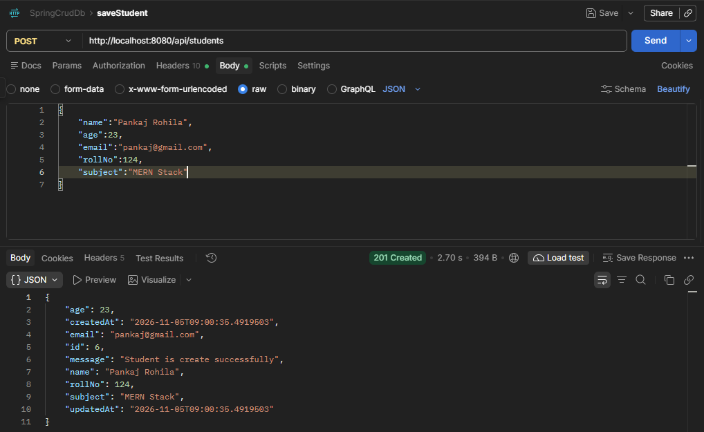
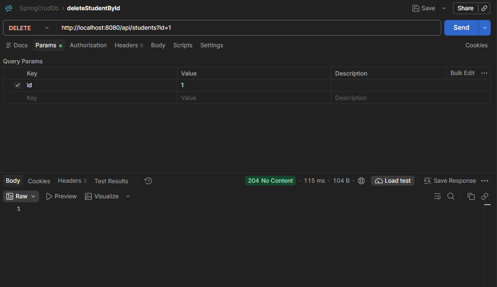
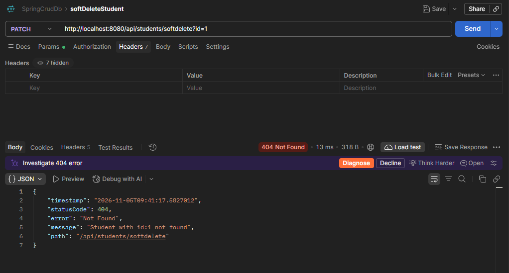
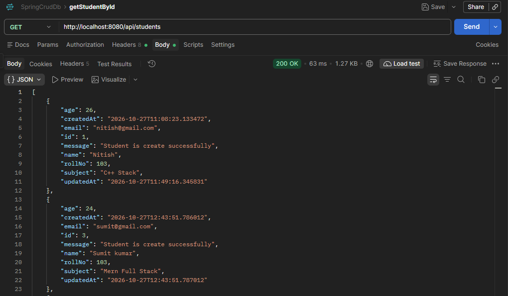
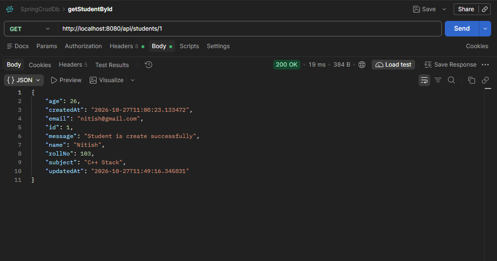
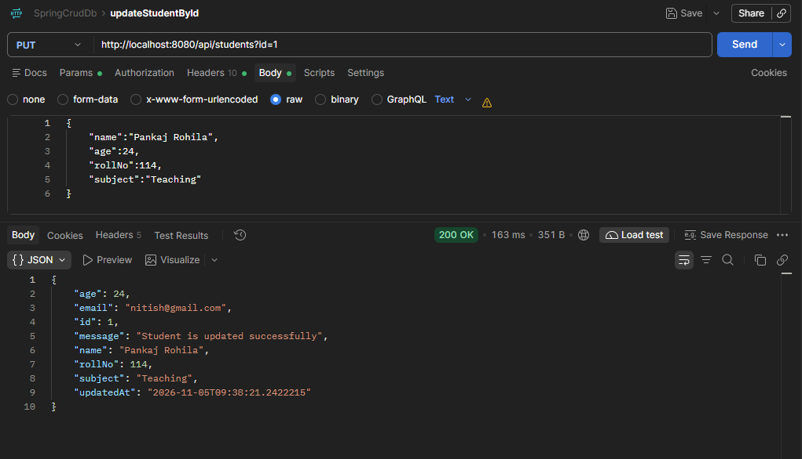

# Student Management System

A RESTful backend application built using **Java 21 and Spring Boot** to manage student records. The application provides CRUD operations, DTO-based request and response handling, input validation, soft deletion, and centralized exception handling with MySQL database integration.

## Features

- **Create Student:** Add new student records.
- **Get Student:** Retrieve student details by ID.
- **Get All Students:** Retrieve the list of students.
- **Update Student:** Modify existing student information.
- **Delete Student:** Delete student records.
- **Soft Delete:** Mark records as deleted without permanently removing them.
- **DTO Pattern:** Separate Request DTO and Response DTO classes.
- **Input Validation:** Validate incoming API requests using Jakarta Bean Validation.
- **Global Exception Handling:** Handle application exceptions centrally using `@RestControllerAdvice`.
- **RESTful APIs:** Follow standard HTTP methods and status codes.
- **Database Integration:** Store and manage student records using MySQL.

## Tech Stack

| Technology | Purpose |
|---|---|
| Java 21 | Programming language |
| Spring Boot | Backend framework |
| Spring Data JPA | Data access |
| Hibernate | ORM |
| MySQL | Relational database |
| Maven | Dependency management |
| Jakarta Bean Validation | Input validation |
| Postman | API testing |

## Project Architecture

The application follows a layered architecture to maintain separation of concerns and improve maintainability.

- **Controller Layer:** Handles incoming HTTP requests and returns API responses.
- **Service Layer:** Contains business logic and processes application operations.
- **Repository Layer:** Communicates with the database using Spring Data JPA.
- **Entity Layer:** Represents database tables.
- **DTO Layer:** Handles request and response data transfer.
- **Exception Layer:** Handles application errors centrally.

## DTO Implementation

This project uses the Data Transfer Object (DTO) pattern to separate API request and response data from database entities.

### Request DTO

- Receives student information from client requests.
- Defines the fields accepted when creating or updating a student.
- Supports validation of incoming request data.
- Prevents direct exposure of entity fields in API requests.

### Response DTO

- Defines the student information returned by the API.
- Controls which fields are exposed to the client.
- Avoids returning the entity directly in API responses.
- Provides a structured response format.

### Benefits of Using DTOs

- Separation of concerns.
- Better control over API request and response data.
- Improved maintainability.
- Reduced dependency between API structure and database entities.

## Prerequisites

Before running the application, install:

- JDK 21
- MySQL 8.0 or later
- IntelliJ IDEA or another Java IDE
- Maven (or use the included Maven Wrapper)

## Database Configuration

### 1. Create a MySQL database

```sql
CREATE DATABASE student_crud_db;
```

### 2. Configure Environment Variables

Set the following environment variables:

```properties
DB_URL=jdbc:mysql://localhost:3306/student_crud_db
DB_USERNAME=your_mysql_username
DB_PASSWORD=your_mysql_password
```

**Important:** Never commit actual database credentials or passwords to GitHub.

## Run Locally

### 1. Clone the repository

```bash
git clone https://github.com/nitish-nk1/student-management-system.git
```

### 2. Navigate to the project directory

```bash
cd student-management-system
```

### 3. Configure the database

Create the MySQL database and configure the required environment variables.

### 4. Run the application

**Windows:**

```bash
mvnw.cmd spring-boot:run
```

**Linux/macOS:**

```bash
./mvnw spring-boot:run
```

### 5. Application URL

Once the application starts successfully:

```text
http://localhost:8080
```

## Application Screenshots

The following screenshots demonstrate the API operations and responses tested using Postman.

### 1. Create Student



### 2. Delete Student By ID



### 3. Exception Message If Already Deleted



### 4. Get All Students



### 5. Get Student By ID



### 6. Update Student



## API Testing

The REST APIs can be tested using Postman.

The application supports the following operations:

| HTTP Method | Operation | Description |
|---|---|---|
| POST | Create Student | Add a new student |
| GET | Get Student | Retrieve student details by ID |
| GET | Get All Students | Retrieve all student records |
| PUT | Update Student | Update existing student information |
| DELETE | Delete Student | Delete a student record |
| PATCH | Soft Delete | Mark a student record as deleted |

Refer to `StudentController.java` for the exact endpoint paths, request formats, and required parameters.

## Validation and Exception Handling

The application uses Jakarta Bean Validation to validate incoming request data.

Centralized exception handling is implemented using `@RestControllerAdvice`.

The application handles errors such as:

- Invalid request data.
- Student not found.
- Operations on already deleted student records.
- Other application-level exceptions.

Meaningful error responses are returned to the client to make API errors easier to understand.

## Database Design

- **Database:** MySQL
- **ORM:** Hibernate
- **Persistence Framework:** Spring Data JPA
- **Primary Key:** Auto-generated student ID
- **Audit Fields:** Created and updated timestamps

## Future Improvements

- Add Spring Security and JWT authentication.
- Implement role-based authorization.
- Add pagination and sorting.
- Implement student search and filtering.
- Add unit and integration testing using JUnit and Mockito.
- Build a React frontend.
- Add Swagger/OpenAPI documentation.
- Deploy the application with a cloud-hosted database.

## Author

**Nitish Kumar**

- GitHub: [nitish-nk1](https://github.com/nitish-nk1)
- LinkedIn: [nitish2509](https://linkedin.com/in/nitish2509)
- LeetCode: [nk_nitish](https://leetcode.com/u/nk_nitish/)

---

If you find this project useful, consider giving the repository a star!